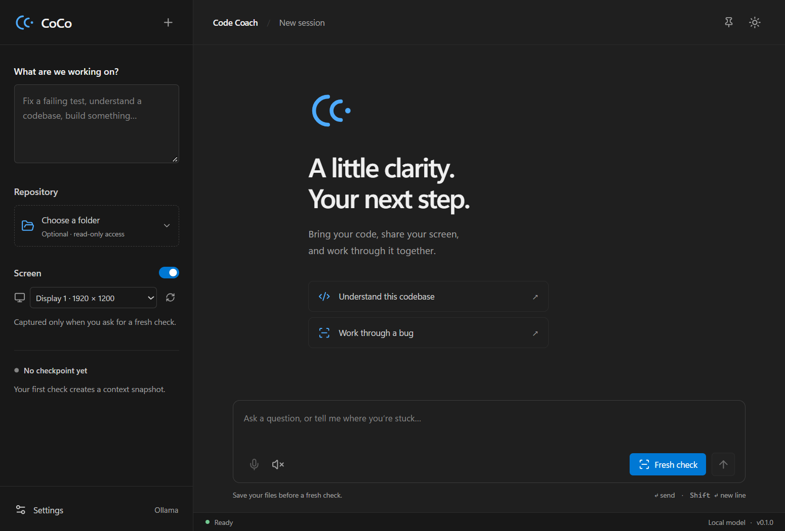

# CoCo · Code Coach

A Windows desktop coach that combines your goal, selected screen, saved source code, and conversation. Built with **Tauri 2, React, TypeScript, and Rust**. Version **0.1.0**.

CoCo gives guidance; you make the edits and run the commands. Observation is manual. There is no continuous screen recording, background AI analysis, or automatic code execution.

Settings includes a saved **Reasoning effort** choice: Auto uses the model default, while verified OpenAI models expose their supported levels. See [model selection](docs/model-selection.md) for compatibility and limits.

Attach **References** from the sidebar: PDFs, text/code files, folders, public web links, or pasted text. Inspect and choose what to share before asking the coach. See [reference support and limits](docs/references.md).

**New session** opens another saved tab. Closing a tab keeps it in **Session history**, where you can reopen, rename, or explicitly delete it. Goals, conversations, drafts, and reference locations save locally; captured bodies remain temporary. See [saved sessions](docs/sessions.md).



[View the light theme](docs/images/light.png)

## Get started

Requirements:

- Windows 10/11 with Microsoft Edge WebView2 Runtime.
- Node.js 22.12+ and npm.
- Stable Rust (1.90+), MSVC toolchain, and Visual Studio C++ build tools / Windows SDK. See [Tauri prerequisites](https://v2.tauri.app/start/prerequisites/).
- Git is optional for reading a code folder; it adds branch/revision information.
- For voice: Windows PowerShell 5.1, System.Speech, an installed desktop speech recognition language, a microphone, and desktop microphone access in Windows Settings. Typed input remains available if voice is unavailable.

```powershell
cd C:\_SourceCode\ghp\coco
npm install
.\start.ps1
```

The launcher starts the Vite development server on **127.0.0.1:1420**, compiles the Rust app, and opens CoCo. It shows timestamped startup/build status and waits for the app window before reporting success. The first Rust build can take several minutes. Logs go to `.local/stdout.log` and `.local/stderr.log`.

```powershell
.\stop.ps1
.\scripts\lifecycle.ps1 -Action status
.\scripts\lifecycle.ps1 -Action restart -Mode dev
```

The stop script identifies its own launcher by PID, creation time, checkout path, and launch token, then force-stops only that launch's process tree, including voice workers. It is a developer shutdown tool; use the tray's **Exit** for a normal, graceful shutdown. It does not stop other Node, Cargo, or manually started CoCo processes. A stale or mismatched PID is never treated as authorization to stop a process.

Both scripts show live terminal progress, completion, and errors. Stop reports success after verifying the tracked processes have ended. `start.ps1 -TimeoutSeconds 900` sets the readiness wait (900 seconds by default); a timeout leaves the launch tracked so you can inspect the logs or stop it. Starting again while CoCo is hidden reports it as already running; restore it through the tray.

Alternatively, run `npm run desktop` in a terminal and stop it with Ctrl+C. `npm run dev` provides a **UI-only browser preview**; capture, repositories, AI, and voice require the desktop app.

## Connect a model

Open **Settings** and choose:

- **Ollama:** start a local Ollama server and select **Recommended** or another compatible installed model. The default server address is `http://127.0.0.1:11434`. Changing the address reloads the list; after installing a model, use **Refresh models**. Only loopback HTTP servers are accepted. CoCo does not install or download models. Verified text-only models are available with Screen switched off.
- **OpenAI:** enter your API key; the list loads automatically one second after typing stops. Choose **Recommended** for the available model CoCo ranks best for this workflow (GPT-6.1 Sol is preferred), or another compatible model. A saved key is reused when opening Settings. Standard API usage is separately billed. The key is saved in Windows Credential Manager only when you save Settings, not in the settings JSON. CoCo 0.1 does **not** implement ChatGPT subscription sign-in.

The dropdown filters for text coaching and, when Screen is enabled, image input. OpenAI capabilities use a checked model policy; Ollama reports its local capabilities. Unknown models are excluded from the normal list. **Enter a model ID manually…** remains an explicit unverified fallback. Discovery retrieves metadata without sending your screen, code, or conversation. The recommendation reason appears below the selector; local recommendations are not hardware benchmarks. [Selection policy and limitations](docs/model-selection.md).

There is no default model or fabricated AI response. Provider errors, unavailable models, quota limits, and incomplete responses are shown directly. CoCo never contacts a model at startup; requests occur only when you send a question or ask for a fresh check.

## Use a session

1. Enter a goal. Optionally choose a code repository and a display or application window.
2. Click **Fresh check**. CoCo briefly hides its window, captures the selected source, scans eligible saved files, and asks for the next step.
3. Follow the guidance. Save your edits and run any suggested checks yourself.
4. Click **Fresh check** again to include current screen and code changes. **Send** / Enter reuses the last checkpoint for clarification. The first Send creates a checkpoint.
5. Click the microphone to start voice input. Wait for **Listening**, speak, then click again to finish. If the goal is empty (or its field is focused before the conversation starts), dictation fills the goal; otherwise it fills your message. Review or edit the transcript and send it. Voice input is never sent automatically.

Shortcuts:

| Action                          | Shortcut         |
| ------------------------------- | ---------------- |
| Fresh check                     | Ctrl+Shift+Enter |
| Start / finish voice input      | Ctrl+Shift+Space |
| Send typed/transcribed question | Enter            |
| New line                        | Shift+Enter      |

Use **Stop speech** to interrupt audio. Starting voice input also stops speech. **Stop** cancels a pending model request in its own session. **New session** creates another tab without discarding the current one. Repository changes reset captured context while preserving that conversation. Goal changes start with a new session so old assumptions do not silently carry over.

Theme options are VS Code **Light Modern**, **Dark Modern**, and system preference. The pin button keeps CoCo above other windows.

CoCo stays in the Windows system tray. **X** / **Alt+F4** hides the window and keeps your session alive. Click the tray icon to restore it, or right-click for **Show CoCo**, **Hide CoCo**, and **Exit**. Windows may place the icon in the tray overflow. **Exit** is the app's only normal quit action; it cancels pending requests and stops voice workers. Hiding the window does not stop an explicitly started voice session or model request. Global shortcuts still work while hidden, and a fresh check leaves the window hidden.

## Package and run

```powershell
npm run package
.\start.ps1 -Mode app
.\stop.ps1
```

The standalone executable is `src-tauri/target/release/coco.exe`. The NSIS installer is under `src-tauri/target/release/bundle/nsis/`. The installer is unsigned; signing and distribution are separate release work. WebView2 may be installed by the Tauri installer if missing. The packaged app does not need Node.js or a development server.

## Documentation

- [Architecture](docs/architecture.md)
- [Model selection](docs/model-selection.md)
- [Privacy and context handling](docs/privacy.md)
- [Development and verification](docs/development.md)
- [Verification results](docs/verification.md)
- [Version 0.1 scope and limitations](docs/version-0.1.md)
- [Changelog](CHANGELOG.md)

## References

Interaction design was informed by [Screen Vision](https://github.com/r-muresan/screen.vision); this implementation is independent. Technical references: [Tauri](https://v2.tauri.app/), [Ollama chat](https://docs.ollama.com/api/chat), [OpenAI vision](https://developers.openai.com/api/docs/guides/images-vision), and [Windows speech](https://learn.microsoft.com/en-us/dotnet/api/system.speech.recognition.speechrecognitionengine).

Optional [OpenAI speech output](docs/speech.md) provides natural AI voices using the existing API key. Windows speech remains the default. Preview and OpenAI spoken replies incur additional API usage charges.

Settings now groups Appearance, AI model, Voice, and API key controls into separate sections. Appearance includes a saved app-wide text-size control (85–150%) with live preview, Cancel rollback, and reset. See [Settings](docs/settings.md).

Track your goal with completion bars, milestone status diagrams, and checkpoints derived from your goal and agreed session plan, with automatic assessment on Fresh check. Existing sessions can load their progress from saved conversation. Manual corrections and Undo keep you in control. Resize or collapse the context sidebar. See [goal progress and layout](docs/progress.md).

Export/import saved sessions through **Session history**: export one session or all sessions to portable JSON, then import as copies. See [session archives](docs/sessions.md#export-and-import).
