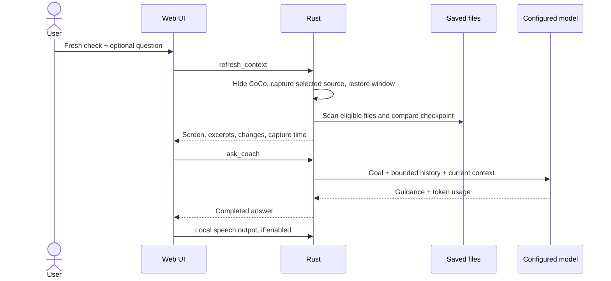

# Architecture

## Runtime

CoCo is a Tauri 2 Windows application. Vite builds the React/TypeScript frontend into static assets. Rust provides the trusted native boundary: directory selection, read-only repository scanning, screen capture, model requests, credential storage, and local speech process lifecycle. There is no bundled Node or Python server.

The webview cannot make network requests to model providers. The content security policy allows only its own assets, Tauri IPC, and in-memory image previews. Remote navigation and model-generated links are not enabled. Markdown has no raw HTML execution. For model traffic, Rust connects either to the fixed OpenAI HTTPS Responses endpoint or a validated local Ollama HTTP loopback endpoint; redirects are disabled. User-added link references use the separate bounded public-HTTPS reader described below.

## Request lifecycle

`models.rs` discovers model IDs through Ollama `GET /api/tags` or the fixed OpenAI `GET /v1/models` endpoint. Credentials are resolved natively from an unsaved key or Credential Manager. Local discovery accepts the same loopback URLs as inference, redirects are disabled, requests time out after 15 seconds, and responses are capped at 1 MiB / 2,000 IDs. Ollama capabilities come from `POST /api/show`, inspected for at most 64 models within 12 seconds (3 seconds/request). OpenAI capabilities/ranks come from the checked `src-tauri/model-policy.json`; the account catalog itself has no capability fields. The webview receives capability metadata without credentials. Unknown capabilities stay unknown. `src/models.ts` filters against the enabled screen input and ranks compatible results. See [selection policy](model-selection.md).

No inference or context upload is involved. Settings debounces key changes by one second and ignores stale responses after provider, URL, or key changes. Recommended resolves to a concrete available ID on Save; it does not silently change a compatible saved choice during inference.

Send without a fresh check reuses the previous context. The first Send captures context. Each successful capture establishes a checkpoint even if the subsequent provider request fails; the next diff is relative to that captured state. This is explicitly distinct from a Git commit or a proven successful coding step.

One model request runs at a time. A cancellation token drops the pending HTTP future. A session epoch discards results from a reset/replaced session. Neither cancellation nor dropping a connection guarantees that a remote provider has stopped processing or billing.

## Repository context

`references.rs` maintains separate session attachments for files, folders, text PDFs, HTML/UTF-8 documents, public HTTPS links, and pasted text. Parsing runs natively, outside the webview. Checked redacted snapshots are appended to each coaching request independently of the repository/screen checkpoint. Manual add/refresh performs extraction; inspection, inclusion toggles, and removal are available in References. No external model or document service is used for extraction. Link retrieval is a separate native HTTPS path with public-address checks, pinned DNS, per-redirect validation, response limits, and no browser authentication. See [reference behavior and limits](references.md).

`repository.rs` walks the selected directory with `.gitignore` and optional `.cocoignore` handling. It skips symlinks and Windows reparse points, generated/dependency directories, common secret paths, lockfiles, binary files, and oversized files. SHA-256 fingerprints compare saved file contents between checkpoints; this works without Git and includes eligible untracked files.

Git is used only for read-only branch and revision identification. No Git diff body is forwarded unfiltered. A branch/revision change starts a new baseline. Text diffs are produced from the same redacted file snapshots used for context. Incomplete scans do not infer deletions.

Selection prioritizes changed files, project documentation/configuration, and goal/question keywords. This is bounded lexical selection, not an AST, vector index, complete dependency graph, or exhaustive repo review. Related files can be missed. Selected source excerpts and diffs are inspectable in the checkpoint dialog.

Bounds: 2,500 eligible files; 192 KiB/file; 24 MiB scanned text; 350 paths in the supplied file map; 14 selected source excerpts with a 42,000-character combined budget and 6,500 characters per file; 24,000 patch characters; up to 120 changed paths in the model request. The latest 16 messages are sent, with each history entry capped at 6,000 characters. These bounds are payload controls, not an exact token estimate.

## Screen capture

`capture.rs` uses xcap for monitor/window enumeration and snapshots. CoCo hides itself before capture and waits briefly for the compositor. A previously visible window is restored even when capture fails, unless it has since been hidden through the tray or closed. A previously hidden window stays hidden. Images are resized within 1920 × 1200 and JPEG encoded. A snapshot can miss small text and does not establish what happened between captures. Protected/minimized windows, HDR, mixed DPI, remote sessions, and device changes need explicit compatibility verification.

## Voice

`voice.rs` launches a hidden Windows PowerShell 5.1 process with an embedded, fixed helper script. `System.Speech` supplies local dictation and speech synthesis. Recognized text travels over stdout as JSON; stop signals and spoken text travel over stdin. User text is never interpolated into executable shell code. A recognition session has a 90-second limit. Child processes are stopped on application exit.

The first click starts recognition; readiness is explicit. The second click stops recognition and returns the transcript to the composer for review. Speech output omits fenced code blocks. Starting input interrupts output to avoid transcribing the coach itself. Recognition accuracy, dictation vocabulary, and pronunciation depend on installed Windows speech resources and the microphone.

## State

`tray.rs` owns the native tray menu and lifecycle. Tray creation must succeed during startup before close-to-tray behavior is installed. Main-window close requests are prevented and hide the existing webview, preserving its session. Left-click restores, unminimizes, and focuses it; right-click offers Show CoCo, Hide CoCo, and Exit. Only tray Exit permits a normal application exit. It cancels the model request and stops local speech children before exiting; the final exit event repeats cleanup safely. Hiding does not implicitly cancel user-started work. The process-scoped developer stop script can still force-stop its own complete launch tree. OS shutdown, crashes, and external process termination are outside the normal app lifecycle.

Settings reside in Tauri's app configuration directory under the `dev.coco.codecoach` identifier. OpenAI keys reside in Windows Credential Manager (`CoCo` / `openai-api-key`). `sessions.rs` saves goals, drafts, conversations, reference locations/pasted text, options, and usage in versioned per-session JSON with atomic replacement, backups, and an exclusive store lock. Each open tab has an independent runtime for history, requests, references, and captures. Screenshots, repository contents/diffs, and extracted file/web bodies stay temporary. See [saved sessions](sessions.md) for resume behavior, recovery, limits, and the optional `COCO_DATA_DIR` override. No telemetry is created.

## Checkpoint progress

`progress.rs` validates optional per-milestone assessments returned with coaching guidance. Fresh check supplies a checkpoint number; matching fresh context, opt-in, and an unlocked milestone are required. Assessment mode extends trusted provider instructions and the output budget while retaining the same request. Local parsing validates statuses, bounds, and IDs; missing completion evidence becomes Needs verification. Session completion applies progress and chat in the same saved document. Snapshot comparisons protect concurrent plan edits; an epoch rejects stale autosave progress. Undo reverses unchanged AI values while preserving manual overrides. Assessment history is bounded to 30 snapshots (latest six visualized). JSON output is requested without requiring provider-specific schema support; invalid output leaves statuses unchanged and exposes a notice.

Empty plans bootstrap on the first explicitly requested coaching reply, or via Load session progress for a saved session. The payload includes bounded early/recent saved conversation to recover the original agreed plan as well as current evidence. Generated titles/statuses are validated, native UUIDs replace model temporary IDs, and missing completion evidence is downgraded. Loading saved progress does not refresh screen/repository capture. New plans enable subsequent Fresh check assessments; existing plans preserve their saved switch. No provider requests occur merely on tab open/switch.
